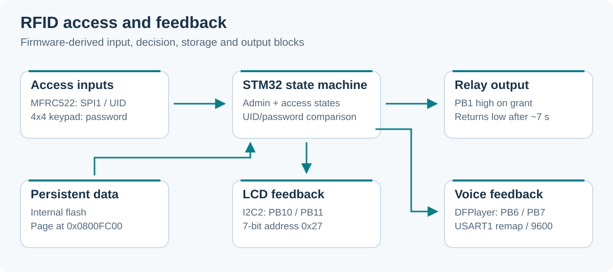

# RFID Door Lock

**An STM32 door-lock prototype with RFID access, keypad passwords and an on-device admin menu.**

STM32F103C8T6 · MFRC522 · 4×4 keypad · I²C LCD · DFPlayer Mini · Custom Altium PCB

<a id="english"></a>

**English** · [Tiếng Việt](#tieng-viet)

Course project for Embedded System Design at HCM University of Technology. The firmware checks a card UID or keypad password, activates a relay for about seven seconds, and provides LCD/voice feedback. An admin card opens the password and card-management menu.



*Architecture derived from the STM32 firmware and peripheral drivers.*

[Video/demo folder](https://drive.google.com/drive/folders/1EJyoBcpR5TI39vi5_LgunK4Ymn7jQt8R?usp=sharing)

## Features

| Function | Current implementation |
|---|---|
| Card access | Compare four UID bytes against the stored card list |
| Password access | Numeric keypad entry and comparison with the stored password |
| Admin menu | Change password, add/delete a scanned card, view stored cards |
| Persistence | `SystemData` stored in the STM32 internal flash |
| Outputs | Relay on PB1, I²C LCD messages and DFPlayer audio tracks |
| Access window | Relay returns low after the elapsed timer exceeds `7000 ms` |
| Invalid attempts | At five failures enter a timed lockout; normal timeout resets the failure count |

The code defines 5/10/20-minute thresholds at 5/7/9 failures. In the normal state-machine flow, the first lockout occurs at five failures and resets the counter on expiry, so routine repeated lockouts are **five minutes**. The higher thresholds are conditional branches, not a demonstrated escalation sequence.

## Repository layout

```text
RFID_Door_Lock/
├── Firmware/RFID_Door_Lock/       # STM32CubeIDE project and .ioc
│   └── Core/
│       ├── Src/                   # State machine and peripheral initialization
│       └── Lib/                   # RC522, keypad, LCD, DFPlayer, flash storage
├── Hardware/01_Design/            # Altium project, schematics and PCB
├── BTL_HW_V1.0.0/                 # Earlier hardware package, models and references
└── Docs/                         # Technical requirements and README illustration
```

## Firmware pin map

| Connection | Configured MCU pins / setting |
|---|---|
| MFRC522 SPI1 | PA5 SCK, PA6 MISO, PA7 MOSI |
| MFRC522 select/reset | PA4 chip select (RFID module often labels it SDA), PB0 reset |
| Keypad rows | PB12, PB13, PB14, PB15 |
| Keypad columns | PA8, PA9, PA10, PA11 |
| LCD I²C2 | PB10 SCL, PB11 SDA; 7-bit address `0x27` (`0x4E` in the HAL call) |
| DFPlayer USART1 | PB6 TX, PB7 RX through USART1 remap; `9600 baud` |
| Relay output | PB1, driven high for access granted |

Match these settings against your PCB revision and module voltage/interface requirements. The remapped USART avoids the keypad's use of PA9/PA10.

## Build and first use

1. Clone the repository and import the existing project under `Firmware/RFID_Door_Lock` into **STM32CubeIDE**.
2. Open [main.c](Firmware/RFID_Door_Lock/Core/Src/main.c) and set `ADMIN_UID` to your own admin card's four UID bytes.
3. Review [the flash storage configuration](Firmware/RFID_Door_Lock/Core/Lib/Storage/flash_storage.h). It starts at `0x0800FC00`, the final 1 KB page of the target's 64 KB flash. Reserve that page when arranging the application image.
4. Prepare the DFPlayer micro-SD card with playback indices **1-4**: granted, denied, locked, admin. Verify the actual playback order; `DF_Play` uses general track command `0x03`, not MP3-folder filename addressing.
5. Build for the configured STM32F103C8T6, connect ST-Link and flash the application.
6. On a fresh storage page, the initial password is `12345` and the card list is empty. Use the admin menu to configure the prototype.

```bash
git clone https://github.com/TuanLinh05/RFID_Door_Lock.git
```

The audio files are expected on the DFPlayer card and are not supplied in this checkout.

### Keypad controls

| Context | Key | Action |
|---|---|---|
| Password entry | `0`-`9` | Append a digit, up to five digits |
| Password entry | `A` | Delete the last digit; cancel when empty |
| Password entry | `D` | Submit the entered password |
| Admin menu | `1` | Enter and confirm a new five-digit password |
| Admin menu | `2` | Scan a card to add it, or remove it if already present |
| Admin menu | `9` | View the stored card list |
| Admin menu | `A` | Return to normal access mode |

## Design files and troubleshooting

Open [BTL_HW_V1.0.0.PrjPcb](Hardware/01_Design/BTL_HW_V1.0.0.PrjPcb) in Altium Designer to inspect the current hardware copy. Keep it consistent with the firmware pin map; the older package is under [BTL_HW_V1.0.0](BTL_HW_V1.0.0).

| Symptom | Check |
|---|---|
| Card never recognized | SPI wiring, PA4 select, PB0 reset and the actual card UID |
| LCD blank | I²C2 wiring, backpack address and display contrast |
| No voice | DFPlayer power, remapped UART, baud and micro-SD track numbering |
| Password/card changes disappear | Flash page reservation, erase/program result and storage magic |
| Keypad functions swapped | Row/column order and the mapping in `keypad.h` |
| Relay never returns low | State-machine timing and PB1 electrical behavior |

Storage uses a plain password and UID list. This is an educational access-control implementation; it does not add cryptographic card authentication. Flash writes and blocking feedback delays should be reviewed when extending the firmware.

---

<a id="tieng-viet"></a>

## Tiếng Việt

[English](#english) · **Tiếng Việt**

Khóa cửa mẫu dùng **STM32F103C8T6**, mở bằng UID thẻ MFRC522 hoặc mật khẩu bàn phím, báo trạng thái trên LCD và DFPlayer. Relay PB1 mở khoảng **7 giây**. Thẻ admin cho phép đổi mật khẩu, thêm/xóa thẻ và xem danh sách.

### Cài đặt

1. Import `Firmware/RFID_Door_Lock` vào STM32CubeIDE.
2. Đổi `ADMIN_UID` trong `main.c` thành UID thẻ admin của bạn.
3. Đối chiếu [bảng chân](#firmware-pin-map) với PCB. DFPlayer dùng USART1 **PB6/PB7 remap**, không dùng PA9/PA10 của keypad.
4. Chuẩn bị track chỉ số **1-4** trên DFPlayer (mở cửa, từ chối, bị khóa, admin), kiểm tra đúng thứ tự phát rồi build/nạp bằng ST-Link. Wrapper hiện dùng lệnh `0x03`, không chọn file theo tên trong thư mục MP3.
5. Khi flash dữ liệu chưa được khởi tạo, mật khẩu mặc định là **12345**, danh sách thẻ rỗng. Dùng admin để cấu hình.

Menu admin: `1` đổi mật khẩu năm chữ số, `2` thêm/xóa thẻ đang quét, `9` xem danh sách, `A` thoát. Khi nhập mật khẩu, `A` xóa/hủy và `D` xác nhận.

### Lưu ý triển khai

- Flash dữ liệu bắt đầu tại `0x0800FC00`; cần chừa trang cuối cho `SystemData` khi bố trí firmware.
- Nhánh khóa có các mốc 5/10/20 phút, nhưng luồng bình thường khóa tại lần sai thứ năm rồi đặt lại bộ đếm khi hết hạn. Vì vậy không nên hiểu là đã có chuỗi leo thang 5 -> 10 -> 20 phút trong vận hành thông thường.
- Mật khẩu và UID được lưu trực tiếp; đây là prototype môn học dựa trên so khớp UID.

Schematic/PCB hiện tại nằm trong [Hardware/01_Design](Hardware/01_Design), bản hardware cũ trong [BTL_HW_V1.0.0](BTL_HW_V1.0.0), yêu cầu kỹ thuật trong [Docs](Docs). [Video demo](https://drive.google.com/drive/folders/1EJyoBcpR5TI39vi5_LgunK4Ymn7jQt8R?usp=sharing).

---

Developed by [Vu Tuan Linh](https://github.com/TuanLinh05) · HCMUT.
